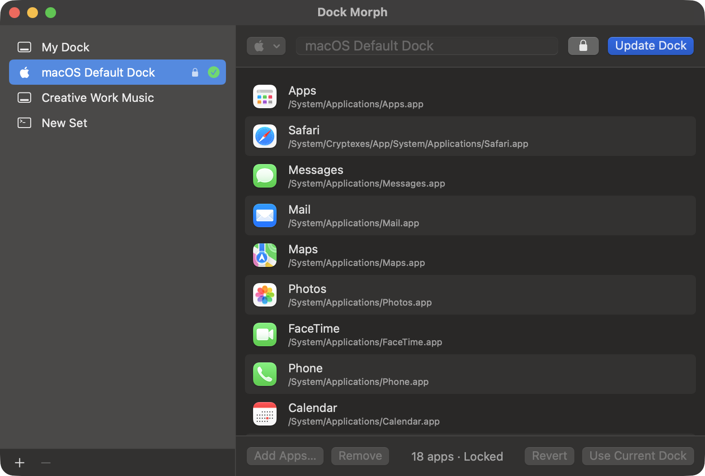
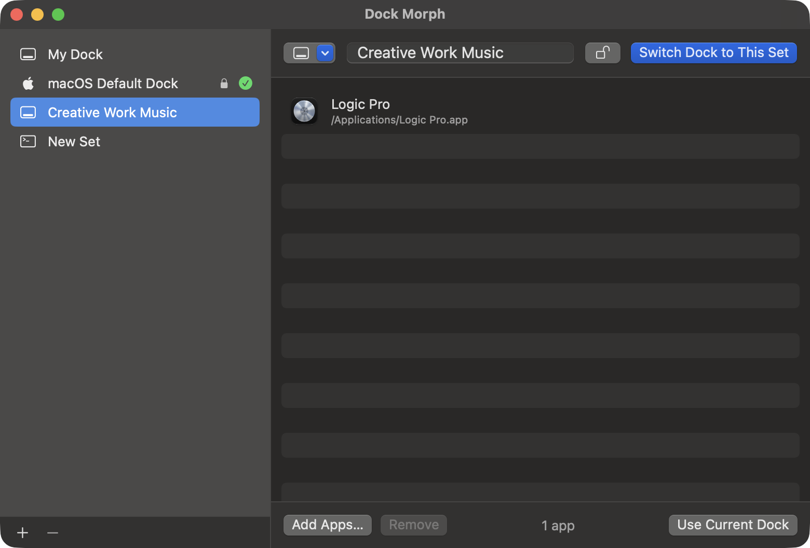

# Dock Morph

A macOS menu bar app that switches the Dock between named sets of apps — one for creative work,
one for research, one for development, and so on.



A small, focused set — just Logic Pro for music work:



## Build and run

```bash
./build.sh
```

```bash
open "build/Dock Morph.app"
```

Requires macOS 13+ and the Swift toolchain (Command Line Tools are enough). To keep it around,
copy `build/Dock Morph.app` to `/Applications` and turn on **Launch at Login** from its menu.

## Using it

- On first launch Dock Morph saves the Dock as it is now as a set called **My Dock**.
- **Menu bar icon** — pick a set to switch to it (⌘1–⌘9 while the menu is open). The icon shows
  the active set's symbol.
- **Edit Dock Sets…** — add, rename, duplicate and delete sets; add apps with **Add Apps…** or by
  dragging them in from Finder; drag rows to reorder.
- **macOS Default Dock** is built in: it holds the apps Apple ships in a new Mac's Dock, can't be
  deleted, and **Revert** restores it if you've changed it.
- **Lock** (the padlock next to a set's name) stops a set from being renamed, edited or deleted
  until you unlock it. The built-in set starts out locked.
- **New Set from Current Dock** — arrange the Dock by hand, then capture it as a set.

Switching rewrites the app section of the Dock (`persistent-apps` in `com.apple.dock`) and runs
`killall Dock`. Finder, the Trash, and the folders/stacks on the right side are left alone. Apps
that are running but not in the set still show in the Dock until you quit them, as usual.

## Command line

```bash
"build/Dock Morph.app/Contents/MacOS/DockMorph" --list
```

```bash
"build/Dock Morph.app/Contents/MacOS/DockMorph" --apply "Development"
```

```bash
"build/Dock Morph.app/Contents/MacOS/DockMorph" --revert "macOS Default Dock"
```

## Files

- Sets: `~/Library/Application Support/DockMorph/sets.json`
- One-time backup of the original Dock tiles: `~/Library/Application Support/DockMorph/original-dock-backup.plist`
